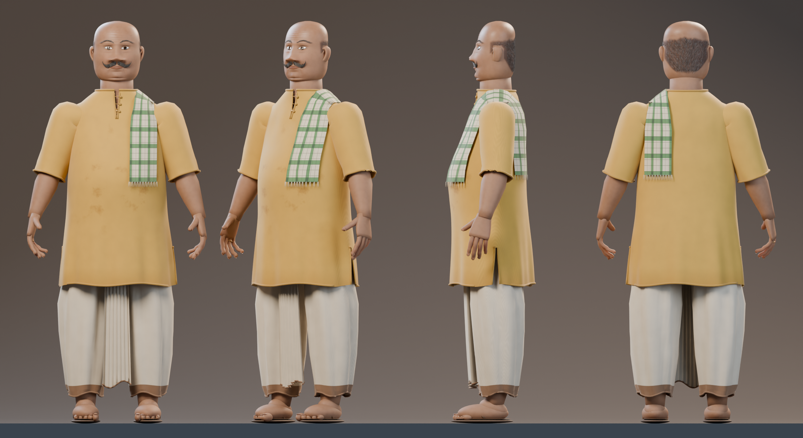

# हलवाई (Halwai), the rooftop witness

Chapter 1 witness who saw the oil pot float from his roof and who points across the grain market to the gate during the interrogation.



| File | Use |
| --- | --- |
| `Halwai.blend` | Editable character. Opens on the turnaround. Scenes: `Halwai` (the asset at the origin, rest pose), `Halwai • Turnaround`, `Halwai • Portrait`, `Halwai • Pointing`, `Halwai • Rooftop read` |
| `Exports/CH_Halwai.fbx` | Neutral rest-pose rig and meshes, with speech, blink, brow and smile shapes |
| `Exports/CH_Halwai_Check.json` | FBX round-trip report (52 bones, shapes, groom counts) |
| `Previews/Halwai_*.png` | Turnaround, portraits, pointing pose, close-up, rooftop readability shot, side-by-side with Gopal |
| `tools/halwai.py` | His face, groom, wardrobe, poses (`relaxed_pose`, `pointing_pose(yaw, pitch)`) |
| `tools/civilian.py` | Reusable adult townsperson base for the other witnesses and the crowd |
| `tools/build_halwai.py` | Rebuilds all of the above |

## Look and recognition

He has to read as the same man on the rooftop, on the refuge slope and in the interrogation, wet or dry. So he's recognised by features he can't lose:

* **Silhouette:** short (about 1.65 m), broad and round-bellied, with a bald crown and a grey-black horseshoe fringe.
* **Face:** wide and jowly, with a double chin, a broad bulbous nose and heavy hooded eyes. He has a thick salt-and-pepper handlebar moustache with upturned ends and a mole on his left cheek.
* **Costume:** a faded turmeric kurta with sweet-shop stains on the belly, an off-white ankle-length dhoti with a brown border, a green-checked gamchha over the left shoulder, leather chappals, a brass tabeez on a black thread and a brass ring on his right ring finger.

The gamchha is green on purpose. Nandu's red shoulder cloth is a plot clue, so no witness should carry red near the shoulder.

Proportions are realistic, like the Vikram reference: head scale 0.76, the same value as `proportions.REALISTIC_HEAD`, so the new cast shares one head-to-body ratio.

## Rig

The rig keeps all 34 bones of the shared cast skeleton, so existing clips apply. It adds `finger_0N_mid`/`finger_0N_tip` and `thumb_tip` on both hands, for 52 bones. Facial controls are the rig custom properties used by the main cast: `Mouth_*` visemes, `blink_L/R`, `brow_raise`, `brow_frown`, `mouth_worry` and `mouth_smile`. They also drive the strand brows and lashes, and lift the moustache with open-mouth shapes.

Arms and kurta sleeves share a short weight ramp at the shoulder joint (`civilian.SHOULDER_RINGS`), so when the arms hang down the shoulder rolls round instead of folding into a square corner. His spec sets `shoulder_drop` lower than the default for sloping, round shoulders.

To pose him in another file, append the `CH_Halwai` collection. Then, from a Python console with `Blender/tools` on `sys.path`:

```python
import halwai
rig = bpy.data.objects['Halwai_Rig']
halwai.pointing_pose(rig, yaw=52, pitch=-6)   # yaw: degrees to his right; pitch: negative points down
```

## Rebuild

```powershell
blender --background --factory-startup --python-exit-code 1 --python Blender/tools/build_halwai.py
blender ... --python Blender/tools/build_halwai.py -- --quick --compare   # fast renders plus a side-by-side with Gopal
blender ... --python Blender/tools/build_halwai.py -- --no-render         # build and export only
```

The build writes only Halwai files and doesn't touch the cast library or other characters.

## Known limits

* The skin, textile, check and tint shaders are procedural. They need baking or rebuilding in Unity.
* Hair, brows, lashes and moustache are tapered mesh strands weighted to the head, which makes the FBX about 25 MB.
* The kurta, dhoti and gamchha are skinned, not simulated. Large leg strides will need cloth simulation or corrective shapes.
