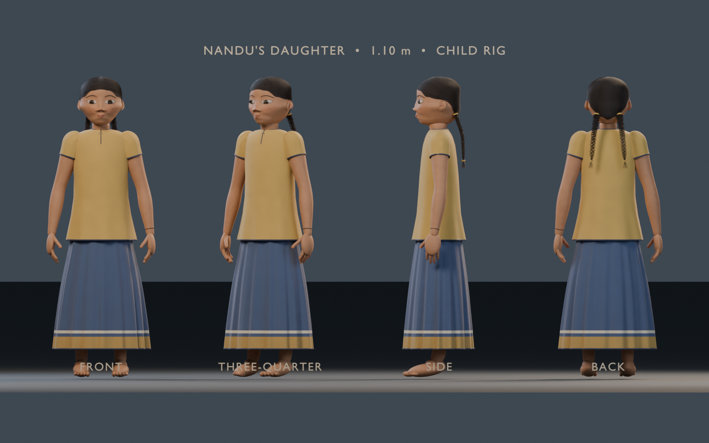

# Nandu's daughter (नंदू की बेटी)

A 5–6 year old village girl, 1.10 m tall, built on the reusable child rig. She is small enough to slip between the adults in the crowd; her head reaches an adult's waist. The reed toy boat passes from her hand to Nandu's and back.

| File | Use |
| --- | --- |
| [Nandu_Daughter.blend](Nandu_Daughter.blend) | Editable model, rig, facial controls and pose assets |
| [CH_NanduDaughter.fbx](Exports/CH_NanduDaughter.fbx) | Neutral model and skeleton for Unity |
| [Turnaround](Previews/NanduDaughter_Turnaround.png) | Front, three-quarter, side and back |
| [Face study](Previews/NanduDaughter_Portrait.png) | Front, three-quarter and profile close-ups |
| [Boat hand poses](Previews/NanduDaughter_Boat_Hands.png) | Carry, offer and take back the reed boat |
| [Crowd height](Previews/NanduDaughter_Crowd_Height.png) | Standing between adults from the cast library |



## Using her

Open `Blender/Nandu_Daughter.blend` in Blender 5.2.2. The `NanduDaughter` scene holds the `CH_NanduDaughter` collection. To use her in a shot, append that collection.

- **Rig.** The armature uses the 34 bone names shared with the adult cast, so body clips stay interchangeable. It adds two-segment fingers and thumbs (`finger_01_mid.L`, `finger_01_tip.L`, `thumb_mid.L` and so on) and non-deforming `prop.L` / `prop.R` sockets at the palm centres.
- **Pose assets.** The Asset Browser lists four poses: `Stand`, `Carry boat`, `Offer boat` and `Reach to take back`. They are actions named `NanduDaughter pose | <name>`.
- **Face.** Animate the armature's custom properties: the eight speech shapes (`Mouth_Ah`, `Mouth_O`, `Mouth_Ee`, `Mouth_MBP`, `Mouth_FV`, `Mouth_U`, `Mouth_L`, `Mouth_Consonant`), `blink_L`, `blink_R`, `brow_raise`, `brow_frown`, `mouth_worry` and `mouth_smile`. The milk teeth show with `Mouth_Ah` and the tongue with `Mouth_L`. Rotate the `eye.L` and `eye.R` bones for gaze.

## The reed boat hand-off

The boat is one shared prop, built by `Blender/tools/reed_boat.py`, which is identical in Nandu's branch. It is 13 cm long and 4.5 cm wide, sized to her palm. Its origin is the centre of the hull bottom.

In a shot, add one boat and give it a **Child Of** constraint for each hand that holds it: her `prop.R` (and `prop.L` when she uses both hands) and Nandu's hand socket. Key the constraint influences to pass it from her to Nandu and back. `attach_boat` in `build_nandu_daughter.py` shows how to place it on her palm for each grip.

| Pose | Grip |
| --- | --- |
| Carry boat | Lengthwise on her cupped right palm, bow along her fingers |
| Offer boat | Across both palms, side by side at chest height |
| Reach to take back | Open hands raised, palms up, as Nandu lowers it |

## Rebuilding

The generator writes the `.blend`, the FBX and, with `--renders`, the previews. `--only turnaround|portrait|hands|crowd` renders one preview; `--no-save` skips writing the `.blend` and FBX. The crowd preview links the adults from `Vikram_Betal_Cast.blend` and does not change it.

Replace `blender` with `D:\Tools\Blender\blender-5.2.2-windows-x64\blender.exe` (see [AGENTS.md](../AGENTS.md)).


```powershell
blender --background --factory-startup --python-exit-code 1 --python Blender/tools/build_nandu_daughter.py
blender --background --factory-startup --python-exit-code 1 --python Blender/tools/build_nandu_daughter.py -- --renders
```

| Module | Contents |
| --- | --- |
| `child.py` | `ChildCharacter`, the child proportions, face, fingers, facial controls and pose tools |
| `child_hair.py` | The centre-parted braided groom and child brows |
| `nandu_daughter.py` | Her colours, clothes, threads and poses |
| `build_nandu_daughter.py` | The build, FBX export and review renders |

## Reusing the child rig for Gopal's niece

Write a new module like `nandu_daughter.py` with its own `SPEC` and dress function. Give it a new name, colours, `ChildProportions` (height, head and limb factors) and `ChildFace` (eye size, nose, cheeks, smile). A `BraidStyle` with a different seed and hairline gives a different braid groom. Then copy `build_nandu_daughter.py` and point it at the new module. The bone names, finger bones, palm sockets, facial controls and pose tools need no changes.

## Unity

Import `CH_NanduDaughter.fbx` with **Animation Type** set to **Generic**, **Avatar Definition** set to **Create From This Model**, and blend shapes enabled. Recreate these Blender materials in Unity:

- the cornea, a clear gloss over the iris;
- the rosy cheeks, which come from a `Blush` attribute that FBX does not carry (paint them into the face texture);
- the strand hair, which uses the `FiberUV` map for anisotropic highlights.

## Guesses to confirm

These come from the story or are mine, not the director's:

- Age 5–6 and 1.10 m tall.
- A centre parting and two plaits tied with turmeric thread.
- A turmeric cotton kurti over an indigo ghagra with an ochre border, and bare feet.
- Black protective threads on her left wrist and right ankle, and a kala teeka on her left cheek.
- No red anywhere on her, because Nandu's red shoulder cloth is evidence in the story.
