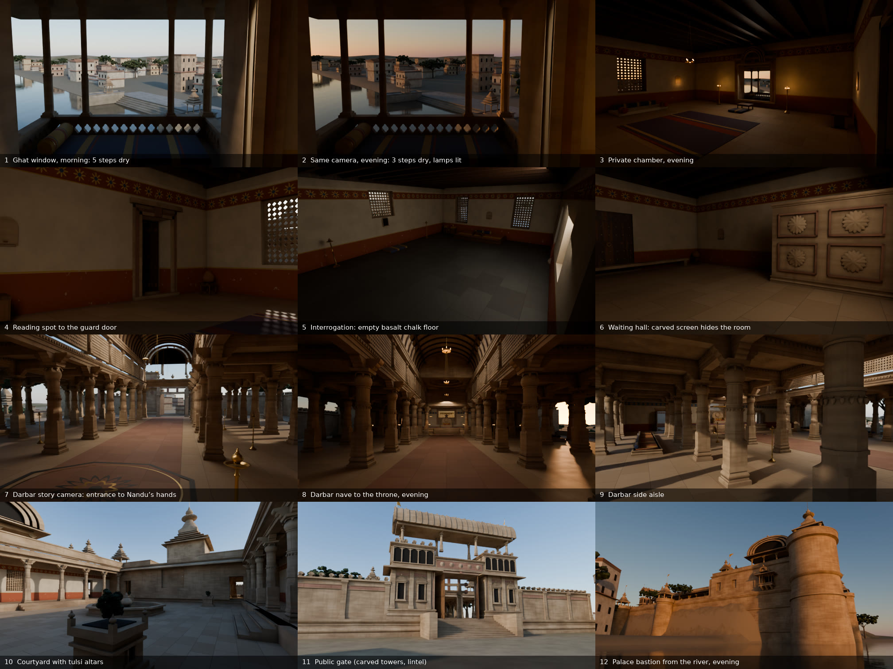

# Set 1 — महल (palace): private chamber, interrogation and open darbar

`SET_Palace.blend` is the Chapter 1 palace set. Python generators in `Blender/tools/` build it, so it can be rebuilt after any change. The palace sits on a river bluff at the bend, about 60 m from the ghat. It shares one world map with the ghat, the river and the town, so later sets can join it in the right place.



## What is in the set

| Area | Story use | Key objects and marks |
| --- | --- | --- |
| निजी कक्ष (private chamber) | Vikram reads statements by the ghat window; the guard speaks from the door | Jharokha window bay with seat and drapes, guard door (left open), reading cushion, gaddi, rug, lamps. Marks: `reading`, `guard_door` |
| पूछताछ (interrogation room) | The chalk map is drawn on the floor; the clerk writes; witnesses come in one at a time | Empty, flat dark-basalt floor (4.0 × 3.2 m zone), clerk's takht and writing desk, witness door (closed). Marks: `chalk`, `clerk_iq`, `witness_door`, `vikram_iq` (guess) |
| Waiting hall | The next witness waits out of sight | Bench, carved privacy screen in front of the witness door. Mark: `next_witness` |
| खुला दरबार (open darbar) | Public hearing; the daughter enters from the public steps and walks to Nandu | 52 carved pillars, shala-vaulted nave, royal platform and throne, judgment-bay lotus inlay, clerk's desk, public entrance steps. Marks: `throne`, `nandu`, `nandu_hands`, `daughter`, `clerk_darbar`, `crowd`; path `daughter_path` |
| Courtyard, gate and walls | Links the wings; public approach | Lotus fountain, tulsi altars, verandahs, carved gatehouse, torana, victory pillar, river bastion with towers and chhatris, saffron pennants |

The chamber and the darbar are built from one architecture kit (`set_kit.py`): pillars, beams, jali screens, doors and frames, shala and phamsana roofs, carved façades, lamps and furniture. Each area has its own collection, so a shot can show or hide the chamber, the interrogation wing or the darbar on its own.

## Time of day

| Frame | Time | River | Dry ghat steps | Lighting |
| --- | --- | --- | --- | --- |
| 1 | Morning | −2.2 m | 5 | Low east sun, lamps out |
| 2 | Evening | −1.4 m | 3 | Low west sun, lamps and diyas lit |

Water level, wet line on the ghat stone, sun, sky, exposure and lamp flames are all keyed on these two frames.

## Story cameras

All cameras are listed in `SET_Palace_Manifest.json` under `cameras`. The main ones are:

* `window`: the fixed ghat-window camera. It shows five dry steps on frame 1 and three on frame 2. `window_tele` is the same view closer in.
* `guard`: from the reading spot to the guard at the chamber door.
* `iq_wide`, `iq_top`: the interrogation room and the chalk floor from overhead.
* `waiting`: the waiting hall. The carved screen hides the interrogation room.
* `darbar_story`: from the royal platform, covering the daughter's entrance, her path and Nandu's hands.
* `darbar_wide`, `darbar_aisle`, `darbar_low`: other darbar coverage.
* `courtyard`, `gate`, `from_river`, `from_ghat`, `aerial`: exterior and map views.

## Sight-line checks

`validate_palace_set.py` ray-casts the built scene and writes `SET_Palace_Validation.json`. All eight checks pass:

1. Window camera, both lenses: exactly 5 dry treads visible on frame 1 and 3 on frame 2.
2. Next witness: 0 of 153 sight lines from the waiting hall reach the interrogation floor.
3. Chalk floor: empty and flat (63 samples, no obstructions).
4. Darbar camera: the entrance and Nandu's hands are in frame and unobstructed, and so is all of the daughter's path (60/60 samples).
5. Reading spot: clear view of the guard at the chamber door.

## Rebuild, check and render

Use Blender 5.2.2. The scripts also run with the `bpy` 5.2.2 Python module.

Replace `blender` with `D:\Tools\Blender\blender-5.2.2-windows-x64\blender.exe` (see [AGENTS.md](../../AGENTS.md)).


```powershell
blender --background --factory-startup --python-exit-code 1 --python Blender/tools/build_palace_set.py
blender --background --python-exit-code 1 --python Blender/tools/validate_palace_set.py
blender --background --python Blender/tools/render_palace_set.py -- --cameras window darbar_story --frames 1 2 --percent 50
```

`render_palace_set.py` writes `Palace_<camera>_<Morning|Evening>.png` to `Blender/Previews/Sets/`. Use `--all` for every camera, and `--samples` for a quick look.

| Script | Builds |
| --- | --- |
| `set_world_map.py` | Shared Chapter 1 map: ghat step sizes, water levels, river course, palace anchor, map anchors for later sets (no Blender needed) |
| `set_materials.py` | Procedural sandstone, basalt, painted lime plaster, slab floors, teak, brass, cloth, water, foliage |
| `set_kit.py` | The architecture and props kit |
| `set_ghat_placeholder.py` | Placeholder terrain, river, ghat and town |
| `build_palace_set.py` | The palace, story marks, cameras, lighting and manifest |

## World map and placeholders

World units are metres, with X east, Y north and Z up. Z = 0 is the ghat's top quay. The palace's local origin is the centre of the darbar floor: +X points to the public gate and +Y to the river façade and the ghat window. The palace floor is at world Z = 10. Its anchor empty, `Palace | Map anchor`, sits at world (83.8, −30.6) and is turned 54°.

The ghat, river, terrain and town are in the collection `PLACEHOLDER | Ghat, river & town (replace with sets 2-3)`. The ghat's step size and the water levels are fixed, because the window check depends on them. The positions of the town gate, the chowki lamp, the market roof and the Halwai's roof are guesses for the ghat and market sets to move. They are listed under `map_anchors` in the manifest, and later sets should import `set_world_map.py` to share the same coordinates.

Other guesses: the architecture follows an early Indian stone style and does not copy any real palace. The basalt floor was chosen so the chalk map reads well. Vikram's standing mark in the interrogation room and the darbar crowd zone are only suggestions.
