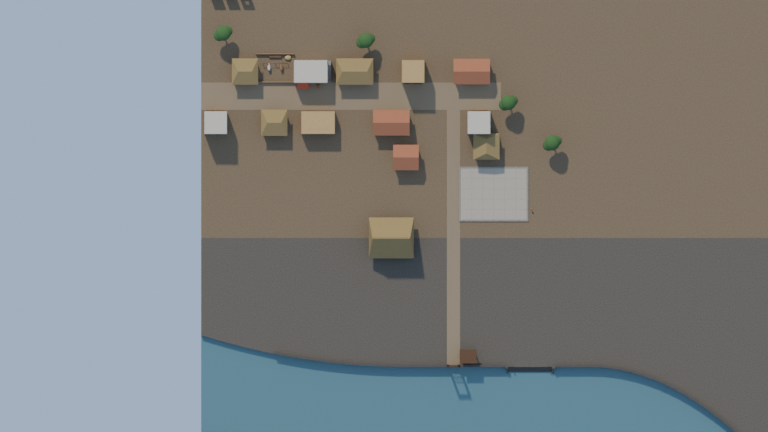

# Set 3 — निचली बस्ती और अनाज मंडी (lower settlement and grain market)

`SET_Town.blend` is the town behind the ghat: the Halwai's roof, the front roof, the neighbour's cattle place, the tall grain-market shed, an open refuge floor and modular houses. It uses the same map as `SET_Palace.blend` and `SET_Ghat.blend`: metres, +X east, +Y north, Z = 0 at the top quay, origin at the top step centre. The ghat terrain, low wall, gate and chowki are rebuilt in the group `Ghat context (from SET_Ghat)` so the gate can be tested against the market roof.



## What is in the set

| Area | Contents |
| --- | --- |
| हलवाई की छत | Flat roof at Z 4.5 m with a parapet, a solid east stair with a gap in the parapet, shop counter and awning, kadhai, jalebi tray and oil jars. Marks: `MARK \| Halwai roof eye` (6.2 m) and `MARK \| Halwai west-parapet stance` |
| सामने की छत | House across lane A with a flat roof at Z 3.35 m, drying line, and `MARK \| Front roof — the boy who shouted` |
| पड़ोसन का मवेशी बाँधने का स्थान | Neighbour's thatched house, a walled yard 10.5 × 8 m, hitching rail, two tethered cows, trough and hay |
| अनाज मंडी का ऊँचा छप्पर | Raised platform, 12 posts, tie beams and a tall thatch roof with its ridge at (−38, 34, 9) m, plus sacks, a wheat heap and a weighing beam |
| शरण के लिए खुला फ़र्श | 18 × 14 m flagstone floor with kerbs, flat and unroofed. `MARK \| Refuge floor zone (keep clear)` |
| मॉड्यूलर मकान | 9 houses on a 3 m bay grid, with loose solid, door and window wall modules in `Kit row` |
| Ground | Town ground, lane A (east–west) and lane B (from the ghat to lane A), four neem trees |

Modular houses mix 1 and 2 floors and flat, thatch and tile roofs. Each house is one root empty, so it can be moved or turned as a unit.

## Sight lines (checked by `validate_town_set.py`, 22 of 22 pass)

* From the Halwai roof eye, the ghat is visible: the low-wall coping, a mooring post and the east step cheek wall.
* All 12 gate samples are hidden. The only object that hides them is the market shed's thatch roof. Without the shed, all 12 would be visible.
* The sight line to the gate crosses the shed at x = −38.3 m and z = 3.9 m, inside its footprint and below the 9 m ridge.
* The boy on the front roof is in line of sight of the Halwai roof. The front roof is 2.9 m below the Halwai eye, so it does not hide the ghat.
* From the Halwai west parapet, the whole cattle place is visible.
* The refuge floor is flat within 1 cm over 42 samples, open to the sky, with nothing on it.
* The stair landing is level with the roof, and the parapet gap lets a person walk onto it.
* No footprints overlap, and houses stay off the lanes.

## Cameras

`CAM | Halwai roof eye to the ghat` (35 mm, active), `… (wide)` (20 mm), `CAM | Halwai west parapet to the cattle place`, `CAM | Front roof to the Halwai roof`, `CAM | Lane A looking west`, `CAM | Mandi shed from lane B`, `CAM | Refuge floor`, `CAM | Cattle place` and `CAM | Top map (town, market, ghat)`.

## Rebuild, check and render

Replace `blender` with `D:\Tools\Blender\blender-5.2.2-windows-x64\blender.exe` (see [AGENTS.md](../../AGENTS.md)).

```powershell
blender --background --factory-startup --python-exit-code 1 --python Blender/tools/build_town_set.py
blender --background --python-exit-code 1 Blender/Sets/SET_Town.blend --python Blender/tools/validate_town_set.py
blender --background Blender/Sets/SET_Town.blend --python Blender/tools/render_town_set.py -- --percent 50 --samples 32
```

`render_town_set.py` writes `Town_<camera>.png` to `Blender/Previews/Sets/`. Use `--all` for every camera.

| Script | Builds |
| --- | --- |
| `town_layout.py` | Positions, footprints, house specs and sight-line samples (no Blender needed) |
| `town_kit.py` | Materials, wall modules, roofs and the house assembler |
| `town_world.py` | Ground, lanes, Halwai roof extras, front roof, refuge floor, trees |
| `town_market.py` | Grain-market shed and the cattle place |
| `build_town_set.py` | Runs all of them, saves the `.blend` and `SET_Town_Manifest.json` |
| `validate_town_set.py` | Ray-cast checks, writes `SET_Town_Validation.json` |
| `render_town_set.py` | Review stills |

## Guesses and limits

* Every position except the Halwai eye, the shed ridge and the gate is a guess. The Halwai eye and the ridge come from the palace `map_anchors`, and the gate from the ghat set. Both are still marked as guesses there.
* The Halwai roof eye does not see the ghat's west end. The shed covers everything from x = −5 m westward, which is what hides the gate. The west end of the ghat is therefore not visible from the roof.
* The 0.75 m riverside wall hides the quay ground behind it, so the Halwai sees the wall, the posts and the step cheek walls rather than the treads.
* Cows, trees, sacks and furniture are simple placeholder shapes. No people are included.
* The ghat in this file is context only. `SET_Ghat.blend` remains the source for the gate, chowki and boat, and the two files are not yet merged into `SET_Palace.blend`.
* The scene is a single morning frame with a sun and a plain sky. Night and the palace's evening lighting are not set up.
