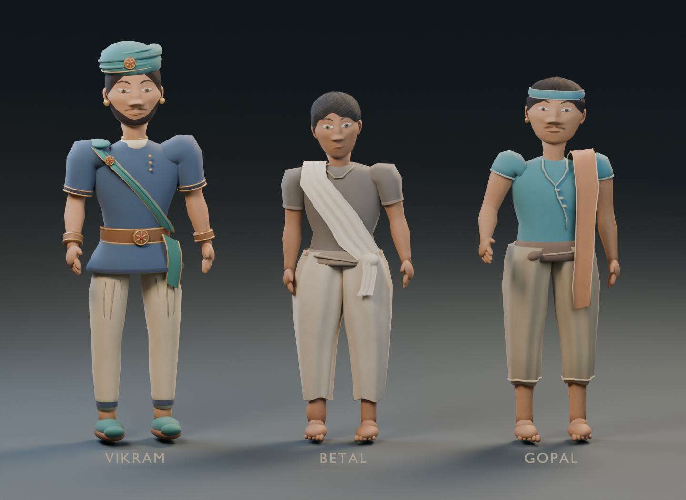

# विक्रम-बेताल: तर्क पच्चीसी

Hindi animated series made with Blender and Unity. The first chapter is **सात गवाह, एक आवाज़**.

| File | Use |
| --- | --- |
| [Chapter 1](अध्याय%2001%20-%20सात%20गवाह,%20एक%20आवाज़.md) | Original Hindi story |
| [Chapter 2](अध्याय%2002%20-%20जिस%20मुहल्ले%20में%20कोई%20नहीं%20मरा.md) | Original Hindi story |
| [Pilot shooting script](Production/E01/E01_SC04_Pilot_Shooting_Script.md) | Gopal's testimony, 11 shots at 24 fps |
| [Dialogue cue sheet](Production/E01/E01_SC04_Dialogue_Cues.csv) | Hindi dialogue IDs, provisional timing, performance notes and WAV filenames |
| [Blender cast library](Blender/Vikram_Betal_Cast.blend) | Editable Vikram, Betal and Gopal models and rigs |
| [FBX exports](Blender/Exports/) | Rest-pose models with skeletons, skinning and mouth shapes |
| [Surface detail](Blender/Previews/Cast_Detail.png) | Close-up of the strand grooms, skin, eyes, lips and woven cloth |
| [Betal sash motion](Blender/Previews/Betal_Cloth_Wind.mp4) | Three-second wind test at 24 fps |



## Using the cast library

Open `Blender/Vikram_Betal_Cast.blend` in Blender 5.2.2. The file opens on `Cast Preview`. Switch to the `Vikram`, `Betal` or `Gopal` scene to edit a character at the origin. To use a character in a new Blender file, append the corresponding `CH_` collection from the library. Use the armature in Pose Mode for body movement. On the character's `Mouth` mesh, use the `Mouth_Ah`, `Mouth_O`, `Mouth_Ee`, `Mouth_MBP` and `Mouth_FV` shape keys to pose dialogue.

Use the `Surface Detail` scene to inspect the eye contour, iris, lip shapes, hair fibers, and fabric weave up close. Each groom uses tapering mesh fibers weighted to the head. The shared textile shader uses rest-mesh coordinates so the weave follows the garment as it deforms.

Open `Betal • Cloth Wind Test` and scrub frames 1–72 to see the baked sash motion. The panel is pinned at the knot and responds to an animated gust. It has self-collision and collision surfaces on the waist wrap and dhoti. The cloth's custom properties show the sampled peak and its frame. Free the bake in the cloth cache before changing the wind or the garment and baking again.

The FBX files are the starting point for Unity import. Match the Unity materials and cloth setup to the Blender close-up and wind review. The character scenes use the same bone names and 24 fps timebase so later episodes can reuse clips. Add episode-specific material, shots and audio under `Production/E02` and the corresponding episode folder in the Unity project as production progresses.

The editable `.blend` is the working asset. `Blender/tools/build_cast.py` recreates the initial library and exports as kept in this repository. Run it in a separate checkout when testing changes to the generator, since it writes the same output filenames.

```powershell
blender --background --factory-startup --python-exit-code 1 --python Blender/tools/build_cast.py
blender --background Blender/Vikram_Betal_Cast.blend --python-exit-code 1 --python Blender/tools/build_cast.py -- --wind-video
```

For a portable install, use the full `blender.exe` path in the command.
